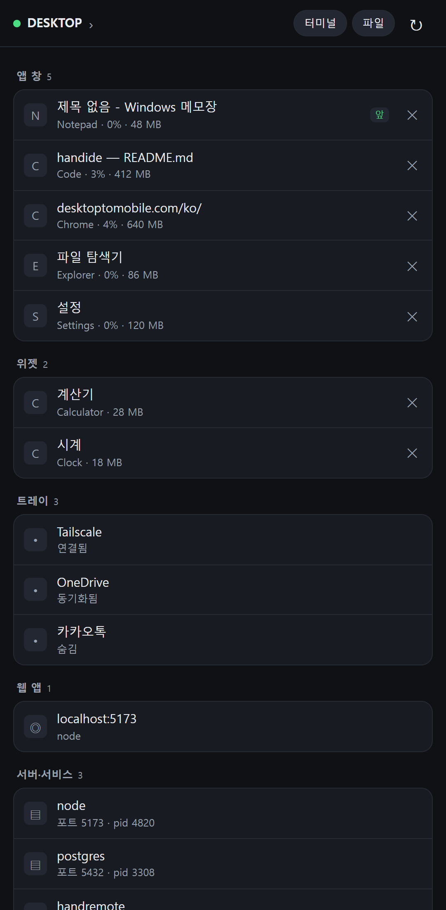
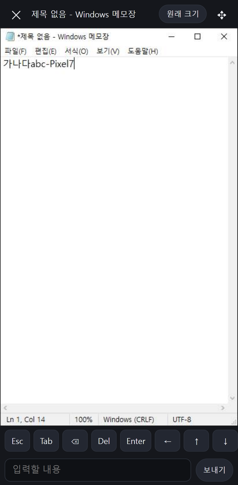
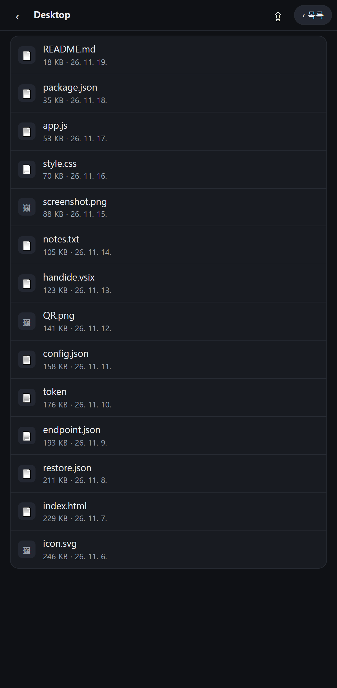

<div align="center">

# handremote

**PC의 창을, 폰 크기로.**

켜져 있는 창·위젯·트레이·서버를 분류별 목록으로 보고, 하나를 누르면 그 창이 폰 화면 크기로 다시 배치되어 열립니다.<br>
줄인 화면이 아니라 앱이 폰 크기에 맞춰 다시 그려지므로 글자가 작아지지 않고, 그대로 탭하고 입력할 수 있습니다.

[](LICENSE)


[English](README.md) · **한국어** · [日本語](README.ja.md) · [简体中文](README.zh-CN.md)

[desktoptomobile.com](https://desktoptomobile.com/)

<br>

<table>
  <tr>
    <td align="center"><br><sub>분류별 <b>목록</b></sub></td>
    <td align="center"><br><sub>폰 크기의 <b>창</b></sub></td>
    <td align="center"><br><sub>PC의 <b>파일</b></sub></td>
  </tr>
</table>

</div>

## 왜 원격 데스크톱이 아닌가

VNC, Chrome 원격 데스크톱, RustDesk 같은 도구는 PC 모니터를 그대로 복사합니다. 1920×1080 가로 화면이 세로 폰에 1/3 크기로 줄어들어, 확대하고 작은 버튼을 겨눠야 합니다. handremote는 반대로 갑니다.

| | 원격 데스크톱 | handremote |
|---|---|---|
| 단위 | 데스크톱 전체 | 창 하나 |
| 크기 | PC 화면을 축소 | 창을 폰 크기로 다시 배치 (닫으면 원래 크기로) |
| 상태 | 픽셀로만 | 트레이, 열린 포트, 서버 프로세스를 목록으로 |
| 입력 | 터치를 마우스 좌표로 | 탭 = 클릭, 길게 = 오른쪽 클릭, 끌기 = 스크롤, 입력창으로 한글 |

## 빠른 시작 (Windows 10/11)

```sh
npm install -g github:YangJongWon/handremote
handremote
```

주 접속은 **handremote · Tailscale**입니다. Tailscale 설치 후 `handremote remote setup`으로 일반 로그인과 연결을 설정하고, `handremote`로 실행합니다. 관리자 API 키나 태그 등록, 다른 앱은 필요하지 않습니다. PC와 폰에서 같은 계정으로 Tailscale을 켜고 터미널의 링크나 QR을 사용하세요. 연결 확인은 `handremote remote status`. [연결 명령 안내](docs/tailscale-app-addresses.md)

`localhost`는 휴대폰 접속 주소가 아닙니다. PC에서 QR을 크게 보는 보조 설정 페이지는 `http://localhost:9100/__handremote/connect`입니다. 같은 Wi-Fi용 LAN 주소로 접속할 때만 자체 인증서 경고가 나타날 수 있습니다.

기본 주 주소는 `https://<PC이름>.<tailnet>.ts.net:9443`입니다. handide와 별도 포트의 독립 서버로 실행되며, **내 tailnet 기기만** 접속됩니다. 공개 링크(Funnel)는 지원하지 않습니다. 이미 설정된 앱 이름 주소도 계속 사용할 수 있습니다.

## 폰 화면

| 분류 | 내용 | 누르면 |
|---|---|---|
| 앱 창 | 작업 표시줄에 있는 창. 프로세스, CPU, 메모리 | 폰 크기로 열기 |
| 위젯 | 항상 위 창, 도구 창 같은 작은 창 | 열기 (크기를 바꿀 수 없는 창은 화면에 맞춰 표시) |
| 트레이 | 알림 영역 아이콘(숨긴 아이콘 포함) | PC에서 클릭하고 열린 메뉴나 창을 바로 표시. 길게 누르면 오른쪽 클릭 |
| 웹 앱 | 페이지를 내주는 localhost 포트 | 폰에서 그 앱 열기 |
| 서버·서비스 | 포트를 열고 있는 프로세스 | 경로, 명령줄, 시작 시각 |
| 파일 | 바로가기, 드라이브, 연 폴더 | PC에서 열거나 폰으로 받기 |
| 터미널 | PC의 PowerShell | 실제 터미널. 나가도 PC에서 계속 실행 |
| 보안 화면 | SYSTEM 도우미가 있을 때, UAC 확인 창이나 잠금 화면 | 자동으로 열림 |

창 보기에서:
- **탭** 클릭, **길게** 오른쪽 클릭, **한 손가락이나 두 손가락 끌기** 스크롤
- **✥** 끌기 모드(텍스트 선택, 슬라이더)
- 아래 **입력창**: 한글 포함 어떤 글자든 그대로 들어갑니다. 비워 두고 보내면 Enter
- 보조키: Esc, Tab, ⌫, Del, Enter, 방향키, Ctrl/Alt/Shift/Win(한 번 누르면 다음 키에 적용), Home, End, PgUp, PgDn, F5
- **원래 크기**: 창 크기를 되돌리고 축소해서 봅니다

창 크기는 바꾸기 전에 `~/.handremote/restore.json`에 기록되어, 폰이 닫거나 handremote가 끝나면(비정상 종료 후에는 다음 시작 때) 원래대로 돌아갑니다.

## SYSTEM 도우미 (선택)

Windows는 일반 사용자 권한 프로그램이 관리자 권한 창, UAC 확인 창, 잠금 화면에 입력하는 것을 막습니다. 이것까지 폰에서 다루려면 한 번 설치합니다.

```sh
handremote helper install     # UAC 승인 1회
handremote helper status
handremote helper uninstall   # 작업, 파일, 정책 변경을 모두 되돌림
```

Chrome 원격 데스크톱 호스트와 같은 구조입니다. 시작할 때 SYSTEM으로 도는 작업이 콘솔 세션에 에이전트를 띄우고, 에이전트는 지금 입력을 받는 데스크톱(일반 또는 보안 데스크톱)을 따라갑니다.

- 네트워크 포트를 열지 않습니다. handremote와는 SYSTEM과 설치한 사용자만 열 수 있는 이름 있는 파이프로만 통신하고, 연결마다 설치한 사용자만 읽을 수 있는 비밀값을 확인합니다.
- 실행 파일은 관리자만 고칠 수 있는 `%ProgramData%\handremote`에 복사해 실행합니다.
- Ctrl+Alt+Del을 보내려고 `SoftwareSASGeneration` 정책을 켜고, 제거할 때 원래 값으로 돌립니다.
- handide의 공개 링크(`--public`, `--cloudflare`)로 열었을 때는 도우미를 쓰지 않습니다(`~/.handremote/config.json`의 `"helperOnPublic": true`로만 허용).

> [!IMPORTANT]
> 도우미가 있으면 링크를 가진 사람이 잠금 화면에 PIN을 입력할 수 있습니다. 링크(`~/.handremote/token`)를 비밀번호처럼 다루세요. `handremote --new-token`으로 바꾸면 예전 링크는 막힙니다.

## handide와 함께

[handide](https://github.com/YangJongWon/handide)(폰에서 쓰는 내 VS Code)와 같은 PC에서 돌면, handide 메뉴에 **PC 화면** 칸이 생깁니다. handide의 주소와 토큰으로 열리므로 따로 북마크할 것이 없고, 웹 앱은 handide의 미리보기로 열립니다. handremote는 `~/.handremote/endpoint.json`에 127.0.0.1 전용 포트와 비밀값을 적어 두고, handide는 그 비밀값을 붙여 `/__handide/screen/`을 중계합니다.

## 명령줄

```
handremote [옵션]
  --port <n>       포트 (기본 9100)
  --local          이 PC에서만 (http://localhost, 인증서 없음)
  --no-remote      Tailscale 링크 없이 (같은 Wi-Fi만)
  --ts-port <n>    Tailscale HTTPS 포트 (기본 9443, 443은 handide 몫)
  --new-token      접속 토큰 새로 발급
```

`~/.handremote/config.json`: `quality`(JPEG 품질, 기본 70), `helperOnPublic`.

## 지원 범위와 알려진 제한

- **Windows 10/11** 전용입니다. macOS는 아직입니다.
- 화면은 창마다 `PrintWindow`로 받습니다. 일부 GPU 가속 창은 검게 나올 수 있고, 그때는 화면에 보이는 부분을 대신 복사합니다.
- 입력하기 전에 그 창을 앞으로 가져옵니다. Windows가 다른 창을 앞에 둔 채 거부하거나 다른 창이 그 자리를 가리면, **엉뚱한 창에 입력하지 않고** 폰에 알립니다.
- 크기를 바꿀 수 없는 창(대화상자, 메뉴)은 그 크기 그대로 화면에 맞춰 보여 줍니다.
- 검사: `npm run check`가 자체 메모장을 띄워 목록, 폰 크기 배치, 한글 입력, 탭, 크기 복원을 Pixel 7과 iPhone 14 에뮬레이션에서 확인합니다. SYSTEM 도우미의 UAC·잠금 화면 동작은 실제 PC에서 따로 확인해야 합니다.

## 라이선스

[MIT](LICENSE)
